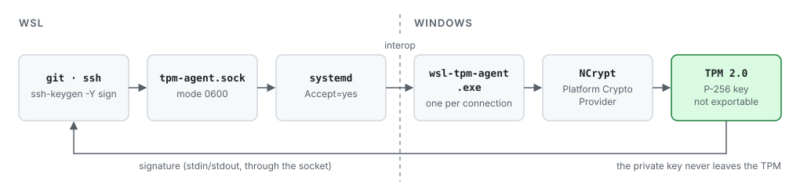

# wsl-tpm-agent

An ssh-agent for WSL that signs with an ECDSA P-256 key kept in the Windows TPM.

`wsl-tpm-agent.exe` creates a key in the Microsoft Platform Crypto Provider and serves the
ssh-agent protocol on stdin/stdout. A systemd user socket in WSL starts one `.exe` per connection
through interop, so `ssh-add`, `ssh-keygen -Y sign` and Git see an ordinary agent socket at
`$XDG_RUNTIME_DIR/tpm-agent.sock`. Signing needs no touch, PIN or dialog, which makes it a fit for
unattended commit signing by coding agents. The commits in this repository are signed with it.

<picture>
  <source media="(prefers-color-scheme: dark)" srcset="docs/signing-flow-dark.svg">
  
</picture>

## Why it exists

WSL has no TPM device (`/dev/tpm*` does not exist), so a TPM-held key has to be used from the
Windows side. Two existing Windows agents can do that in principle. Both were reviewed on
2026-11-04 by reading their code, and both were rejected:

- [WinCryptSSHAgent](https://github.com/buptczq/WinCryptSSHAgent) signs through CryptoAPI and gets
  P-256 right, but it needs an X.509 certificate in `CurrentUser\My`. Its WSL2 transport is a
  Hyper-V socket with no authentication on a wildcard VM id, so any distro or VM on the host can
  ask for signatures. It shows a toast on every signature, lets any client add keys, depends on a
  vulnerable `x/crypto` (CVE-2025-47914) and has had no release since 2021.
- [PKCS11SSHAgent](https://github.com/Sanmilie/PKCS11SSHAgent) uses CNG but copies the raw
  `r‖s` from `NCryptSignHash` into the signature, so its ECDSA signatures do not verify. It does
  not pass `NCRYPT_SILENT_FLAG`, listens on `0.0.0.0:10022` without authentication, has
  out-of-bounds reads reachable from the network and shares buffers between clients. Its licence
  does not allow redistribution.

This agent keeps the parts they got right (open the key through NCrypt, SHA-256 then
`NCryptSignHash`) and leaves out the network listener. It opens keys by name, with no
certificate.

## Installation

The flake builds the Windows executable with Nix (cross-compiled with mingw-w64) and exports a
home-manager module. In the flake of your NixOS-WSL system:

```nix
inputs.wsl-tpm-agent.url = "github:aldoborrero/wsl-tpm-agent";
```

In the home-manager configuration of your WSL user:

```nix
imports = [ inputs.wsl-tpm-agent.homeModules.wsl-tpm-agent ];

services.wsl-tpm-agent = {
  enable = true;
  # keyName = "gfh-sirius";  # offer only this key; default: every gfh-* key
  # debug = true;            # debug lines in the journal
};
```

The module adds two user units:

- `tpm-agent.socket` listens on `%t/tpm-agent.sock` (mode `0600`) with `Accept=yes`.
- `tpm-agent@.service` runs `wsl-tpm-agent.exe agent` for each connection, with the socket as
  stdin and stdout and stderr sent to the journal. A connection lasts at most 60 s, and
  instances are unloaded when they end, failed or not.

Requirements: WSL interop enabled (the default), Windows with a TPM 2.0 that the Platform Crypto
Provider can use, and OpenSSH on the WSL side.

To build the executable alone:

```bash
nix build github:aldoborrero/wsl-tpm-agent
./result/bin/wsl-tpm-agent.exe --help
```

## Usage

Create the key once. `keygen` refuses to overwrite a key that already exists:

```bash
wsl-tpm-agent.exe keygen --name gfh-sirius > ~/.ssh/sirius_tpm.pub
```

It prints one OpenSSH public key line, which you can add to `allowed_signers` and to GitHub as a
signing key. Names may use letters, digits, `.`, `_` and `-`, up to 64 characters, and must
start with a letter or digit. Without `keyName`, the agent offers only keys whose names start
with `gfh-`, so other keys in the provider stay hidden.

Point a client at the socket:

```bash
export SSH_AUTH_SOCK=$XDG_RUNTIME_DIR/tpm-agent.sock
ssh-add -L
ssh-keygen -Y sign -n git -f ~/.ssh/sirius_tpm.pub message
ssh-keygen -Y verify -f ~/.ssh/allowed_signers -I me -n git -s message.sig < message
```

For Git, use the key as an SSH signing key (`gpg.format = ssh`,
`user.signingkey = ~/.ssh/sirius_tpm.pub`), with `SSH_AUTH_SOCK` pointing at this socket or at an
`ssh-agent-mux` that includes it.

Each signature writes one line to the journal:

```console
$ journalctl --user -u 'tpm-agent@*'
wsl-tpm-agent.exe[2470032]: wsl-tpm-agent: info: signed key=gfh-test bytes=95 namespace=git
```

To delete a key, use Windows tools:

```bash
certutil.exe -user -csp "Microsoft Platform Crypto Provider" -delkey gfh-sirius
```

## Security model

- The executable never listens. It reads requests from stdin and writes answers to stdout, for
  one connection, and exits when the input ends. Access control is the permission of the socket
  in your runtime directory (`0600`, owned by your user), which systemd creates.
- Only two requests get an answer: `REQUEST_IDENTITIES` and `SIGN_REQUEST`. Everything else,
  including adding, removing or locking keys, gets `SSH_AGENT_FAILURE`.
- Frames longer than 256 KiB, or empty, close the connection before the body is read. Every
  length inside a message is checked against the bytes left before it is used; a malformed
  message gets `FAILURE`.
- Every NCrypt call that accepts it gets `NCRYPT_SILENT_FLAG`. If a key's policy would need a PIN
  or consent dialog, signing fails instead of opening a window that nobody sees.
- `keygen` creates keys with the provider defaults: not exportable, signing only, no UI policy.
  The private key never leaves the TPM.
- The log records key name, data size and SSHSIG namespace. It never records the signed data.
- `unsafe` code exists only in `crates/wsl-tpm-agent/src/ncrypt.rs`, where Rust calls
  `ncrypt.dll`. The protocol crate has `#![forbid(unsafe_code)]`.

## Limitations

- Any process running as your Windows user can use the key. The TPM stops anyone from copying it
  but places no limit on who uses it. Register the key in GitHub as an unattended signing key and
  keep it out of repositories that need a human approval for every signature.
- Inside WSL, anyone who can open the socket can sign, which in practice means processes of your
  WSL user.
- Only ECDSA P-256 keys in the Platform Crypto Provider. No RSA, no keys from other providers.
- Each connection starts a Windows process: one signature takes about 0.15 to 0.2 s on the
  machine it was tested on.
- A connection open for more than 60 s is closed. Requests take a fraction of a second and
  OpenSSH closes the agent connection after authentication, so only a client that never finishes
  hits this limit.
- There is no Hyper-V socket, TCP listener, Windows service or remote key management, and none is
  planned.

## Development

```bash
nix develop          # or direnv allow
just test            # cargo test, including ssh-add/ssh-keygen against a fake TPM
just lint            # clippy for Linux and for the Windows target
just check           # nix flake check
just build           # result/bin/wsl-tpm-agent.exe
just try-units       # start the socket from this checkout (transient units)
just try-sign        # create gfh-test, list, sign, verify, delete it (on Windows hardware)
```

The protocol, the ECDSA encodings and the serve loop live in `crates/protocol` and are tested on
Linux, with a software P-256 key standing in for the TPM. The specification, plan and tasks are in
`specs/001-tpm-ssh-agent/`.

## License

Apache-2.0. See [LICENSE](LICENSE).
